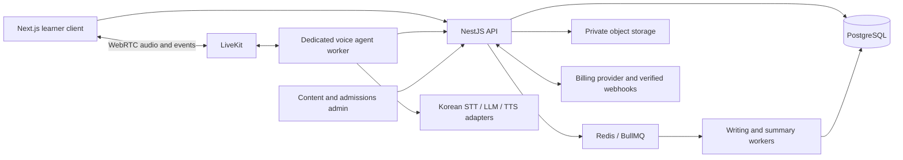

# Kigaru investigation and Korean learning application plan

Research date: 2 November 2026, Asia/Seoul. Scope: public information, public website observation, published app listings, and independent architecture planning. No application implementation has begun.

The recommended direction is a web-first Korean learning product using Next.js, NestJS, PostgreSQL, a dedicated real-time voice worker, an original Rive tutor, and selected 3D scenes. Treat TOPIK preparation and university applications as distinct workspaces connected by the learner’s goals and qualifications.

## 1. REA installation and compatibility

### Installation completed

Initially, the local Codex configuration had no REA registration, no REA tools were exposed, and `rea` was absent from PATH. After the user authorized installation:

- Verified the official upstream as [morluto/rea](https://github.com/morluto/rea), linked to the official npm package `rea-agents` and website `rea.tools`. Similar names and copied READMEs are not reliable provenance.
- Queried npm and installed **rea-agents 6.8.0** globally under the existing Node **24.22.1** installation. The shell’s default Node **20.19.6** was left unchanged.
- Reviewed setup’s dry-run, then applied setup only for Codex. Registration: `/Users/aaaaa/.codex/config.toml`; backup: `/Users/aaaaa/.codex/config.toml.rea.backup`; bundled skill: `/Users/aaaaa/.agents/skills/reverse-engineer-anything`.
- Setup returned `ready`. A direct stdio MCP handshake identified REA 6.8.0 and advertised **229 tools**. `list_browser_targets` succeeded against a dedicated loopback Chrome instance. REA’s CLI also produced page, bundle, screenshot, and interaction evidence.
- Codex’s persistent tool integration requires a client restart to appear in its ordinary tool catalog. Direct MCP verification and CLI use allowed this research to proceed without restarting the conversation.

Current requirements are Node 22.x ≥22.23.4, 24.x ≥24.22.1, or ≥26.12.1, plus npm. Setup previews configuration changes and installs matching workflow instructions. Native analysis engines are optional and target-dependent. [Official installation guide](https://github.com/morluto/rea/blob/main/docs/installation.md), [package metadata](https://github.com/morluto/rea/blob/main/package.json).

The install reported a deprecated transitive package and an unapproved Frida install script. Frida was not enabled; browser inspection worked without it. No Hopper, Ghidra, JADX, Java, Android SDK, or mobile application was installed.

### Platform support is uneven

| Target | Supported scope | Requirements and limits |
|---|---|---|
| Web | Page/accessible structure, loaded scripts, static bundle analysis, selected network observations, screenshots, declared browser actions | Chrome-family browser; passive capture uses CDP. Website behavior does not reveal a private backend. |
| Android | APK manifest/classes/methods; resource inspection; device observation through separate tools | Static code analysis requires full JDK 17+ and supplied headless JADX bridge; device work needs supplied adb and an authorized emulator/device. |
| iOS | IPA/app inventory, bundle anatomy, resources and framework hints; compatible native artifact analysis where available | Requires a legitimately obtained artifact. Inventory is not live iPhone automation, runtime proof, or a means to decrypt protected store binaries. |

REA supports all three as investigation targets, but it does **not** provide identical turnkey device automation for all three. [Web guide](https://github.com/morluto/rea/blob/main/docs/browser-observation.md), [Android guide](https://github.com/morluto/rea/blob/main/docs/android-analysis.md), [Apple inventory guide](https://github.com/morluto/rea/blob/main/docs/apple-application-analysis.md).

## 2. Kigaru technology and architecture findings

Evidence labels used throughout:

- **Observed:** directly inspected public page, script, screenshot, or browser interaction.
- **Published:** a statement by Kigaru or its store listing, not independently tested.
- **Inference:** a plausible interpretation of evidence.
- **Unknown:** not established by accessible evidence.

| Layer | Finding | Confidence and boundary |
|---|---|---|
| Marketing frontend | Astro-generated asset paths, including a `BaseLayout.astro` script and three CSS files | Observed; strong framework fingerprint for this website only. |
| Browser logic | Two same-origin loaded modules, approximately 5.6 KB combined source, implementing menu, motion and download-link behavior | Observed within the captured page; not a repository inventory. |
| Fonts | Google Fonts requests for Hanken Grotesk, Poppins, Noto Sans JP and Caveat | Observed network/resource declarations. |
| Rendering | HTML/CSS interface and DOM transforms in the inspected landing page | Observed. No Three.js, Rive or GSAP imports found in its two captured scripts. This bounded result does not describe every Kigaru surface. |
| Navigation | Single-page section anchors, privacy/terms pages, and external store links | Observed. No functional browser lesson client was identified through the inspected navigation. |
| Mobile distribution | iOS/iPadOS and Android listings exist | Published listings, not an installed-device inspection. |
| Mobile framework | React Native, Flutter, Swift/Kotlin, or another implementation | Unknown. Shared visual design and a version suffix are insufficient evidence. |
| Backend | Framework, services, infrastructure, database, authentication vendor | Unknown. |
| AI stack | Model, STT/TTS providers, orchestration, vector store, training approach | Unknown. |
| API transport | REST, GraphQL, WebSocket, WebRTC, direct model connection | Unknown for the mobile app. |

REA statically analyzed both captured scripts and returned **zero endpoint candidates** and zero route patterns. The initial passive capture began after page load, so it could not recover earlier traffic. The subsequent mobile scenario recorded page loading and public interactions, but exercised no learning session. These observations do not prove Kigaru lacks APIs.

The site describes conversation, recurring learning patterns, and future learning paths as three coordinated systems. This is a **published product abstraction**, not evidence of three backend agents, three services, or any particular model architecture. [Kigaru website](https://kigarutalks.com/).

The privacy policy says account/profile information, practice audio/text, and usage are collected for service delivery and personalization. It does not name the AI vendors or database. Its encryption and deletion statements are policy claims, not independently audited technical findings. [Privacy policy](https://kigarutalks.com/privacy).

## 3. Features and the user journey

### Feature inventory

| Feature | What evidence supports | What remains unknown |
|---|---|---|
| Voice conversations | AI speaking practice and responsive conversation are advertised | Latency, interruption reliability, audio transport, providers |
| Speech recognition | Listening to learner speech is advertised; voice processing is described in policy | Whether speech is separately transcribed or handled by an end-to-end audio model |
| Speech playback | Published store image shows a speaker icon beside Japanese text | TTS versus prerecorded audio, voice selection, replay behavior |
| Grammar feedback | Store description advertises immediate grammar feedback | Error taxonomy, accuracy, explanations and correction timing |
| Pronunciation feedback | Store description advertises pronunciation feedback | Acoustic scoring method, phoneme support, calibration and reliability |
| Personalization | Adaptation to level, pace and goals is advertised | Placement algorithm and actual recommendation behavior |
| Lesson modes | Lessons and Free Talk are referenced in the listing/release history | Full catalog, exact unlock rules and lesson screen hierarchy |
| Hands-free | iOS version history references hands-free improvements | Availability by device/plan and exact controls |
| Learning profiles | Policy lists language level, goals and preferences | Profile screen layout and editable fields |
| Progress | Website describes capability-based readiness | Actual dashboard, scoring, history, streak mechanics and retention evidence |
| Translation | Release history references real-time/image translation | Current limits, quality, entitlement and UI |
| Monetization | Free download with in-app purchases | Current user-specific offer, trial, paywall trigger and quotas |

Sources: [Google Play listing and published screenshots](https://play.google.com/store/apps/details?id=com.kigarutalks.conversations), [iOS listing and release history](https://apps.apple.com/us/app/speak-japanese-kigaru-talks/id6749827005), [privacy policy](https://kigarutalks.com/privacy). Published descriptions establish claims, not measured effectiveness.

### Seven-stage journey, with explicit gaps

This is the fullest defensible reconstruction from public evidence. It is **not a verified end-to-end mobile walkthrough**.

| Stage | Evidence-supported journey | Unverified details | Design implication for our product |
|---|---|---|---|
| 1. Onboarding | Website introduces the speaking problem and routes to app stores. Account and profile concepts appear in policy. | First-run screens, login providers, permissions, order of questions | Ask goal and support language; offer an immediate short demonstration; request mic access when practice begins. |
| 2. Proficiency assessment | Level-adaptive practice is advertised. | Whether a formal placement test exists, duration, score scale, placement algorithm | Offer self-placement plus a skippable diagnostic; assess reading/listening separately from speaking. |
| 3. Lesson selection | Public site demonstrates everyday situations and a custom situation prompt. | Actual catalog navigation, filtering and progression gates | Provide recommended next practice, browseable scenarios and custom roleplay. |
| 4. AI conversation | Public mockup shows transcript turns and hold-to-speak; store material shows a large microphone control. | Actual push-to-talk behavior, hands-free setup, retries, interruption states | Always expose listening, processing, speaking and reconnecting states; include typed fallback and captions. |
| 5. Feedback | Site demonstrates a learner phrase followed by a more natural expression, then repetition. | Whether the actual app uses that layout and how it scores speech | Preserve intended meaning; show one useful correction, explain register, replay and retry in context. |
| 6. Progress | Site frames progress through useful capabilities. | Actual history screen, mastery calculation and whether earlier app versions differ | Track evidenced skills, scheduled review, speaking time and TOPIK attempts separately. |
| 7. Subscription | Store purchases and subscription terms are public. | Offer order, trial eligibility, restore flow, cancellation UI and entitlement behavior | Show an understandable allowance and renewal terms; offer upgrade after demonstrated value; support restore and billing management. |

The website says its correction approach is selective and its progress framing emphasizes readiness rather than streak pressure. Those are product claims. They should not be extended into a claim that the mobile app has no scores or streaks. [Kigaru website](https://kigarutalks.com/).

The US iOS listing exposes multiple product records, for example three months at $49.99 and twelve months at $119.99, alongside other prices and translation offers. These are **catalog records**, not confirmation of the offer every user currently receives. The terms describe platform-dependent refunds and subscription conditions. [iOS purchases](https://apps.apple.com/us/app/speak-japanese-kigaru-talks/id6749827005), [terms](https://kigarutalks.com/terms).

### Why the approach may engage learners

My UX interpretation: realistic situations give practice an immediate purpose; private rehearsal lowers social pressure; a visible rephrase makes improvement concrete; retrying the same moment creates a short completion loop; personalized scenarios connect learning to life. These are plausible engagement mechanisms. Public materials do not establish learning gains, retention rates or comparative effectiveness.

## 4. UI and animation analysis

### Direct visual observations

Desktop capture: pale background with diffuse colored light, large dark typography, a blue/purple/coral headline accent, a floating rounded navigation bar, and an angled phone demonstration. The mock phone uses a darker conversation surface, stacked speech/correction panels, a readiness indicator, and a prominent microphone.

A Google Play promotional screenshot uses a different light conversation treatment: close control, scene title/category, large café illustration, Japanese phrase, romanization, English translation, speaker control and microphone. It is a published screenshot, not proof of the current app’s entire design. The landing-page demonstration and store material should not be conflated.

The public page structure proceeds through hero, speaking difficulty, scenario discovery, a four-step practice explanation, personalization, founder story, FAQs and download CTA. Mobile inspection at 390 × 844 successfully opened the menu, navigated to FAQs and expanded the first answer.

### Motion implementation observed in loaded code

| Interaction | Mechanism in inspected website code | Verification limit |
|---|---|---|
| Section entrance | IntersectionObserver adds visibility classes | Code observed; exact CSS timing was not measured. |
| Story sequence | Intersection thresholds select active panels and update a progress meter | Implementation observed; not a mobile app transition. |
| Practice-loop demo | Scroll intersections select one of four panels | Presentational demo, not a live voice session. |
| Parallax/navigation | Passive scroll listeners, requestAnimationFrame, CSS variables and transform updates | Code observed. |
| Horizontal scenario section | Desktop scroll position maps to `translate3d`; threshold above 800 px | Code observed. |
| Pointer response | Tilt and perspective transforms; reset on pointer exit | Fine-pointer interaction code observed. |
| Reduced motion | Checks preference and changes reveal/pointer/parallax behavior | Presence verified; not a complete accessibility certification. |
| Mobile menu and FAQ | Menu state updates accessible attributes; FAQ uses details/summary | Both interactions exercised successfully. |

Evidence: REA page capture `ev_385f7e…`, bundle `ev_30efea…`, desktop screenshot `ev_41484e…`, successful mobile scenario `ev_8ba01e…`. Full IDs and limitations are retained in the accompanying evidence manifest.

One initial attach-mode mobile attempt retained desktop rendering and could not click the hidden mobile menu. That attempt is marked incomplete. A new REA-owned browser with the requested viewport completed all actions and terminated cleanly. This was an inspection limitation, not evidence of a Kigaru bug.

### Direction for the Korean experience

Create an original miniature Korean neighborhood linking a café, campus, convenience store and study room. Use camera composition, lighting and character acting to create continuity. Keep microphone, captions, keyboard input and correction text in a stable semantic interface.

Proposed choreography: brief optional arrival scene; clear character reaction when listening begins; restrained thinking motion; speech-linked mouth movement; a camera transition when changing locations; a short environmental change when a real skill milestone is earned. Audio energy can drive approximate mouth motion; phoneme/viseme events are needed for more precise lip synchronization.

Use Rive for the daily tutor, and an R3F scene for exploration and selected milestones. Give each animated property one owner. Do not run competing Rive, GSAP and frame-loop animations on the same property. Reduced-motion and low-power modes must retain every learning function. Load scenes after useful UI, pause hidden rendering, and limit mobile GPU load while voice processing runs.

The exact “CatOnChair” 3D portfolio reference could not be identified confidently from that name. No stack or animation claims about it are made here. [Bruno Simon’s own portfolio](https://bruno-simon.com/) is a separately verified example of interactive Three.js world-building, useful as a technical reference without adopting its assets or navigation wholesale.

## 5. Proposed independent architecture

### Web first, native later

Choose **Next.js** for the first release: it accommodates cinematic web presentation, desktop writing practice and university comparison in one frontend. Add React Native/Expo clients when speaking retention and paid demand justify platform-specific voice and billing work. Share API contracts, curriculum schemas and domain rules; do not assume React web components or GSAP DOM choreography transfer unchanged to native.

Start with a NestJS modular monolith plus separately deployed voice/evaluation workers. Modules: identity, learner profile, curriculum, assessment, conversation, feedback/review, TOPIK, admissions, checklists, billing and administration. Avoid a microservice per feature at launch.

Next.js server components handle initial content/data, while mic controls, editors and animation use client boundaries. NestJS owns authorization and domain mutations. Ordinary APIs can use versioned REST/OpenAPI; media belongs on WebRTC, with room data/transcript events and asynchronous persistence. [Next.js boundaries](https://nextjs.org/docs/app/getting-started/server-and-client-components), [NestJS queues](https://docs.nestjs.com/techniques/queues), [LiveKit architecture](https://docs.livekit.io/agents/).

### Voice path and assessment

1. Client requests a session; NestJS validates access, allowance and scenario.
2. NestJS issues a short-lived scoped media token. Provider credentials stay on the server.
3. Voice worker loads a versioned scenario, learner level and limited relevant learning memory.
4. Stream microphone audio through Korean STT → dialogue model → Korean TTS, or benchmark a speech-to-speech alternative against the same tests.
5. Deliver incremental captions and agent state. On interruption, cancel speech generation/playback and remove unheard response content from dialogue context.
6. Persist final turns and usage with session/turn IDs. Queue structured feedback and review scheduling after the conversation rather than blocking the next reply.

Choose providers by Korean learner-audio benchmarks, not advertised multilingual support alone. Test 받침, liaison/assimilation, honorifics, code switching, noisy microphones and Bluetooth headsets. Proposed acceptance targets: p95 first response audio within 1.5–2 seconds after turn completion on supported networks, reliable interruption, reconnect recovery and no duplicate turns or usage charges. These are product targets, not current measurements or vendor guarantees.

Keep three assessments distinct: transcript-based grammar/naturalness, acoustic pronunciation, and task completion. ASR confidence or transcript correctness alone is not a pronunciation score. Azure lists Korean pronunciation assessment as a candidate, but feature granularity and locale limitations require validation. [Speech language support](https://learn.microsoft.com/en-us/azure/ai-services/speech-service/language-support?tabs=pronunciation-assessment).

### Data and progression

PostgreSQL entities should include users, learner profiles, consent, curriculum versions, skills, lesson/scenario versions, attempts, conversations, turns, feedback spans, skill evidence, review schedules, exam specifications, writing submissions, rubric versions, university programs, intake requirements, source records, checklist instances, subscriptions, entitlements and usage events.

Store concrete evidence behind mastery: task achieved, relevant correction, repeat performance and last practice. Recompute recommendations from these records rather than relying on an opaque chat summary. Use relational columns for identity/state and bounded JSONB for versioned structured evaluation output. A vector database is not required for launch.

Optional audio belongs in private object storage with explicit retention/deletion policy. Begin university workflows with checklist status and source links; document uploads can follow. If uploads launch, require ownership checks, signed access, malware scanning, retention controls and a clear deletion path. Avoid placing personal documents or raw audio in routine logs.

### TOPIK preparation and writing evaluation

TOPIK I includes listening/reading; TOPIK II adds writing. PBT, IBT and the speaking test are distinct formats. Store exam family, delivery mode, edition and rubric version instead of applying PBT numbering and timing to every format. [Korean government overview](https://www.studyinkorea.go.kr/ko/plan/examAndKoreanStudy.do).

Build original or properly licensed question banks with tagged skills, timed attempts, explanations and error review. Version the exam blueprint and validate it against official materials before content production.

Writing flow: task-specific deterministic checks → rubric-constrained evaluation with evidence spans → estimated score range and criterion feedback → revision → comparison with the earlier submission. Separate task fulfillment, organization and language feedback. Preserve the submitted text and evaluation version. Calibrate against independently teacher-scored work; measure agreement, score error and systematic level bias before claiming scoring quality. Treat answers as untrusted content, not evaluator instructions. Display practice estimates, never official TOPIK results.

### University recommendation and application workspace

Filter eligibility before ranking preferences. Inputs: qualification/degree, grading scale, language scores and validity, subject, budget, location, degree target and intake. Explain each match with its exact evidence and missing requirements. Do not invent admission probabilities.

Requirements must be versioned by university, program, applicant category and intake. Retain official source URL, effective period, checked date and reviewer status. Distinguish “requirement met,” “not met,” “missing evidence,” and “unknown.” Government guidance confirms that language requirements vary by university and department. [Study in Korea](https://www.studyinkorea.go.kr/ko/plan/examAndKoreanStudy.do).

Generate conditional checklist templates covering education records, identity, language evidence, financial evidence, translations/authentication, recommendations and study plans only when the relevant program requires them. Track required/action-needed/submitted/verified states, deadlines and source changes. Start with 10–20 carefully maintained institutions rather than broad unreliable coverage. Publishing and refreshing admissions facts needs a human editorial workflow.

### Billing and operating controls

Proposed business model: free introductory practice with a visible allowance; paid speaking minutes and preparation features; optional writing evaluation credits if unit costs justify them. Validate pricing after measuring actual voice/evaluation cost. Avoid promising unlimited usage before measuring sustainable cost.

NestJS entitlements should reconcile verified webhooks and provider state, with idempotent processing, expiry/refund handling and usage reservations. Plan separately for web billing and native store purchases. Track cost per speaking minute, session failure rate, latency, useful correction rate and repeat practice. Teacher calibration and admissions-source review are ongoing operating costs.

## 6. Recommended libraries and reusable components

These are recommendations for our implementation, not findings about Kigaru.

| Library/component | Reuse | Qualification |
|---|---|---|
| Next.js / React | Web shell, routing, content and interactive boundaries | Keep learning controls functional before 3D assets finish loading. |
| NestJS / PostgreSQL / Prisma | API modules, durable relational model, migrations | Review migration plans and transactional usage/billing updates. |
| LiveKit server, SDKs and Agents | WebRTC, voice agent lifecycle, transcripts, reconnect behavior | Begin with managed infrastructure if operational capacity is limited; provider fees remain separate. |
| LiveKit Agents UI | Transcript, session and audio UI building blocks | Restyle into our original interface. [Official components](https://docs.livekit.io/frontends/agents-ui/). |
| Rive React runtime | Original tutor state machine and interaction | Runtime does not supply an original character; asset authoring/export terms are separate. [Rive runtime](https://rive.app/docs/runtimes/react/react). |
| Three.js / React Three Fiber / Drei | Scene rendering, cameras, GLTF loading and helpers | Lazy-load; pin compatible React/R3F versions. [R3F](https://r3f.docs.pmnd.rs/getting-started/introduction), [Drei](https://github.com/pmndrs/drei). |
| GSAP / ScrollTrigger | Deliberate landing choreography and camera transitions | GSAP has its own license; do not classify it as MIT open source. [License](https://gsap.com/community/standard-license/). |
| shadcn/ui / Radix primitives | Accessible dialogs, forms, tabs, menus and checklist controls | Use component source as a foundation, with independent typography/layout. [Documentation](https://ui.shadcn.com/docs). |
| TanStack Query / React Hook Form / Zod | Server state, forms and validated contracts | Use only where needed; backend validation remains authoritative. |
| BullMQ / Redis | Writing jobs, summaries, retries and scheduled work | Version job inputs; enforce idempotency. |
| Playwright / axe-core / OpenTelemetry | Journey verification, accessibility checks and traces | Supplement automated checks with Korean speech, device and keyboard testing. |

Check each selected release and asset license before adoption. Open-source runtimes, commercial hosted services, authoring subscriptions and reusable media have different rights and costs. Original character/scene production is part of the project budget.

## 7. Roadmap, effort and approval boundary

Estimates assume three experienced engineers, one product designer/motion artist, part-time Korean educator and QA support. They include integration and verification, but depend on prompt content decisions and access to teacher-scored evaluation material.

| Phase | Effort/calendar estimate | Concrete exit condition |
|---|---|---|
| A. Product and feasibility | 3–4 weeks | Approved original design direction; Korean voice benchmark; TOPIK specification; admissions source model; measured cost envelope. |
| B. Speaking MVP | Additional 8–12 weeks | 20–30 original scenarios, one tutor, voice/text fallback, correction/retry, saved progress, account/deletion, billing and usage controls. |
| C. TOPIK preparation | Additional 6–9 weeks | Versioned TOPIK I/II practice and exam simulation; teacher-calibrated writing beta with transparent score estimates. |
| D. Admissions workspace | Additional 4–6 weeks | 10–20 institutions with reviewed intake rules, explainable matching and conditional checklists. |
| E. Cinematic polish and release | 4–6 weeks, partly parallel | Original 3D environment, motion tuning, reduced-motion/fallbacks, device performance and complete release checks. |
| F. Native applications | Additional 8–12 weeks after stable APIs | React Native clients, platform audio lifecycle and billing verified on real iOS/Android devices. |

Planning range: **6–9 months for a polished web release** with the stated team. Speaking MVP: approximately **11–16 weeks including feasibility**. One developer would require substantial scope reduction or a longer schedule. Content authoring, audio calibration, cinematic asset production and admissions maintenance can dominate elapsed time.

Proposed release gates: no critical voice/session/billing failures in supported-device testing; measured latency and interruption behavior; Korean educator acceptance of feedback quality; scored-writing validation results disclosed; every published admissions requirement linked to a current source; functional keyboard/reduced-motion/non-WebGL paths; enforceable data retention/deletion.

Open decisions for plan approval: first learner segment and support languages; web-first release; whether admissions launches alongside speaking or later; one initial tutor and 3D setting; free allowance and pricing experiment. These do not prevent this research from being delivered.

### What this investigation did not establish

No Kigaru APK/IPA was supplied or inspected. No account was created, microphone session run, subscription purchased, private API called, credentials extracted, security bypass attempted or proprietary implementation copied into an application. Consequently, the complete mobile onboarding, placement, progress and subscription screens, live voice performance and backend stack remain unresolved.

The next investigation increment would be an authorized first-run walkthrough on an installed app, followed by a free practice session if available and passive observation of ordinary traffic where permitted. No certificate-pinning bypass or protected binary decryption is proposed. App-specific findings should be updated from that evidence rather than filled with assumptions.

**Approval boundary:** this document is research and architecture planning. REA setup was installed at the user’s explicit request. Application coding, paid services and production deployment have not begun and await plan approval.
