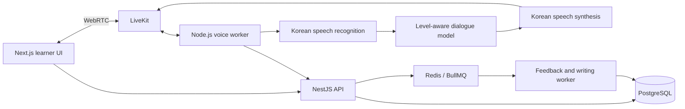

# Korean learning application: proposed build plan

Status: planning only. Application implementation awaits approval.

## Product and first release

Build an original Korean speaking tutor for learners preparing for everyday life, TOPIK and study in Korea. The first release must make one loop work well: choose a situation, speak with an AI tutor, understand a useful correction, retry, and return later to review it.

Proposed launch assumption: adult international learners, beginner through intermediate Korean, English support text and Korean learning content. Interface languages, target countries and initial learner segment should be confirmed when approving the plan. TOPIK exam skill and conversational skill will be tracked separately.

Recommend **Next.js first**, supporting phone browsers and desktop writing practice, with NestJS and PostgreSQL. Add React Native clients after the voice experience and retention are validated. If App Store launch and native mobile behavior are day-one requirements, switch the learner frontend to React Native before implementation and keep Next.js for marketing, writing/admissions tools and administration. Building two complete learner frontends simultaneously is outside the initial estimate.

## What the Kigaru research establishes

The founders' [Devpost submission](https://devpost.com/software/kigaru-talks) declares Flutter, ElevenLabs Scribe, LiveKit, OpenAI, Gemini, Firebase/Firestore and RevenueCat. It describes level-aware conversations, memory and corrections converted to flashcards. This is developer-reported evidence associated with a 2025 submission, not verification of today's production configuration.

Its current TTS provider, model versions, routing and acoustic pronunciation assessment remain unconfirmed. Our use of ElevenLabs TTS below is an independent candidate selection, not a claim about Kigaru. The earlier research report's mobile-framework finding should now be read as **Flutter, developer-reported; not binary-verified**.

The phone walkthrough directly showed a dismissible subscription screen and a lesson timeline with completed/current/upcoming states, plus Lesson, Review and Free Talk tabs. No complete fresh onboarding or voice session has yet been observed. We will create our own interface, curriculum, prompts, characters and assets.

## Release scope

| Stage | Included |
|---|---|
| Speaking MVP | Account/profile, goals, self-placement and short diagnostic, 20–30 original scenarios, guided lessons, Free Talk, voice/text interaction, captions, replay, correction/retry, saved reviews, learning history, one animated tutor, usage limits and billing |
| TOPIK release | TOPIK I/II practice, timed mock attempts, skill explanations, writing workspace, rubric-based writing estimates and revision history |
| Admissions release | Qualifications profile, verified program catalog, explainable university matching, conditional document checklists and deadlines |
| Experience refinement | Original 3D setting, selected cinematic transitions, accessibility, lower-power modes and performance tuning |

For the MVP, commission one tutor and one setting. Defer additional characters, open-world exploration, social feeds, live human tutors, custom voice cloning, fine-tuning, broad university scraping and admissions document uploads. Revisit each only when usage or a release requirement justifies it.

## AI speaking teacher

### Initial architecture

NestJS owns user authorization, lessons, session creation, entitlements and saved learning records. A separate worker owns the real-time audio session. Long-running model work must not block ordinary API requests.

Start with one pipeline, not a generalized multi-provider platform:

| Responsibility | Proposed starting choice | Decision gate |
|---|---|---|
| Media transport/session | LiveKit, initially managed | Demonstrate joining, interruption, reconnection and supported-device audio |
| STT | ElevenLabs Scribe candidate | Test Korean learner speech, code switching, noise and streaming behavior |
| Dialogue | A current stable Gemini model | Korean educator checks language level, naturalness, register and correction reliability; choose the specific model during feasibility |
| TTS | ElevenLabs Korean-capable streaming voice candidate | Verify intelligibility, natural Korean, speed control, permitted commercial use and actual latency |
| Structured feedback | Schema-validated model output | Reject invalid outputs; educator checks factual/grammatical correctness |
| Pronunciation | A separate Korean-capable acoustic assessment service, if validation succeeds | Never infer a pronunciation score from transcription confidence alone |

References: [LiveKit Agents](https://docs.livekit.io/agents/), [ElevenLabs STT](https://elevenlabs.io/docs/overview/capabilities/speech-to-text), [ElevenLabs TTS](https://elevenlabs.io/docs/overview/capabilities/text-to-speech), [Gemini structured outputs](https://ai.google.dev/gemini-api/docs/structured-output).

The first milestone benchmarks this candidate pipeline. Change an unsuccessful component before expanding the curriculum; do not build speculative routing or fallback infrastructure in advance. Provider keys remain server-side. No paid account creation or usage is authorized merely by this plan.

### Tutor behavior

Each scenario defines learner level, communication goal, setting, character role, target expressions, politeness/register, support language and completion criteria. A deterministic session controller tracks the lesson stage; the model produces contextual dialogue within those boundaries.

During conversation, the tutor should use short level-appropriate replies, allow thinking time, offer optional hints and avoid interrupting every mistake. If speech recognition is uncertain, ask for confirmation rather than issuing a confident correction.

After a meaningful exchange or at session end, provide:

- The learner's recognized phrase, editable if recognition was wrong.
- A suggested Korean expression preserving the intended meaning.
- A short explanation, including politeness/register where relevant.
- A replayable model phrase and a retry action.
- A review item only when the learner saves it or the curriculum requires it.

Conversation memory stores limited, relevant learning facts and user-approved interests. It must be editable and deletable. Keep it separate from admissions qualifications and sensitive documents. Do not require weight fine-tuning to deliver an initial tutor.

### Audio lifecycle

Authorize session and reserve allowance → issue short-lived room token → join → check mic → load lesson context → listen/transcribe → generate/speak → save final turn → queue feedback → reconcile usage and end session.

Use stable session and turn IDs. On learner interruption, stop outgoing playback/generation and update model context to reflect what was actually heard. On reconnect, restore the session without duplicating turns or charging twice. Include microphone-denied, muted, no-speech, provider-error and allowance-ended states, plus a typed fallback.

Proposed measured target: p95 first audible response within two seconds of detected end-of-turn on supported devices/networks. This is a development target, not an existing result or provider guarantee. Log transport, recognition, model and playback milestones separately in our own implementation.

## Screen hierarchy and learning journey

| Area | Screens and intended journey |
|---|---|
| Start | Welcome → learning goal → self-placement/optional diagnostic → supported first scenario → permission request when microphone is needed |
| Home | Resume lesson, recommended scenario, reviews due, recent progress and an optional entrance to the 3D setting |
| Lessons | Curriculum/skill path → lesson detail → preparation → guided conversation → feedback → retry/review |
| Free Talk | Choose topic or describe a situation → level/register confirmation → conversation → summary |
| Review | Due items → recall/listen/speak → correction → reschedule |
| TOPIK | Exam family and format → skill practice or timed attempt → explanation/results → writing revision workspace |
| Universities | Qualifications → matched programs → comparison/detail → application checklist |
| Profile | Goals/level, history, saved expressions, preferences, data controls, billing |

Prefer one clear next action on each learner screen. Initial practice should demonstrate value before an upgrade offer. Show allowance, renewal terms, restore/manage options and entitlement changes clearly. A skipped diagnostic must not prevent supported beginner practice.

## Original character and cinematic experience

Use **Rive** for the everyday tutor: idle, listening, thinking, speaking, encouraging, retry and connection-error states. State changes follow actual audio/session events. Audio amplitude can drive approximate mouth movement; do not claim accurate lip synchronization without phoneme/viseme timing.

Use **Three.js + React Three Fiber + Drei** for a small original Korean environment with a café, campus or study room. Use **GSAP** for selected camera and scene transitions. Each animated property has one owner. Rive, GSAP and the rendering loop must not fight over the same property.

Keep microphone controls, captions and corrections in accessible HTML. Support reduced motion, non-WebGL fallback, keyboard access, text enlargement and lower-power devices. Lazy-load the scene after functional UI; pause hidden rendering. A cinematic intro should be optional and should not delay subsequent lessons.

References: [Rive React](https://rive.app/docs/runtimes/react/react), [R3F](https://r3f.docs.pmnd.rs/getting-started/introduction), [Drei](https://github.com/pmndrs/drei), [GSAP license](https://gsap.com/community/standard-license/). Original asset production and authoring licenses are separate work and costs.

## Backend and data model

Use a NestJS modular monolith with modules for identity, learner profile, curriculum, conversation, feedback/review, assessment, TOPIK, admissions, checklists, billing and administration. Deploy voice and background evaluation workers separately because their lifecycles differ from REST requests.

PostgreSQL stores users, consent, curriculum/scenario versions, skills, attempts, conversation turns, feedback spans, review schedules, skill evidence, writing submissions, rubric versions, programs, intake requirements, source records, checklists, subscriptions and usage events. Use Prisma for relational access and reviewed migrations. JSONB holds bounded versioned evaluation structures, not the entire domain model.

Use Redis/BullMQ for asynchronous summaries, writing evaluation and scheduled work. Optional audio goes to private object storage with a defined retention period. Start admissions with checklist status and official-source links; defer document uploads until secure storage and review workflows are in scope.

Use versioned REST/OpenAPI contracts. Do not add GraphQL, a separate vector database or one microservice per feature without a demonstrated requirement. Build an educator/admin workflow for publishing scenarios, reviewing feedback failures and updating admissions sources.

## TOPIK and writing evaluation

TOPIK I covers listening/reading; TOPIK II includes writing. Store exam family, delivery format and specification version; PBT, IBT and speaking formats must not share assumed question counts or timing. [Government overview](https://www.studyinkorea.go.kr/ko/plan/examAndKoreanStudy.do).

Build original or appropriately licensed questions. Writing evaluation combines task-specific deterministic checks, rubric-constrained model assessment, evidence-linked feedback and resubmission comparison. Display practice score estimates with uncertainty, never official scores.

Before release, evaluate against independently teacher-scored responses across target levels. Measure score error, rater agreement, unsupported corrections and level bias. Validate the rubric and exam format with a Korean educator. A model producing valid JSON is not sufficient proof of scoring quality.

## University matching and application checklists

Begin with 10–20 institutions and reviewed program/intake requirements. Inputs include degree/qualification, grading scale, language results and validity, subject, budget and intake. Apply eligibility rules before ranking preferences. Show requirements met, unmet, missing evidence and unknown separately.

Every published requirement needs an official URL, effective intake, checked date and review state. Universities/departments set different language requirements, so there is no universal TOPIK cutoff. Checklists must be conditional on program, qualification and applicant category. Never present an unvalidated admission probability. [Official guidance](https://www.studyinkorea.go.kr/ko/plan/examAndKoreanStudy.do).

## Development sequence and effort

Planning assumptions: three experienced engineers, one designer/motion artist, part-time Korean educator and QA support. Workstreams overlap where dependencies permit. Estimates are judgment, not commitments.

| Milestone | Calendar estimate | Exit condition |
|---|---|---|
| 1. Product scope and voice feasibility | Weeks 1–3 | Approved audience and original visual direction; working Korean audio round-trip; measured quality/latency/cost; first five scenarios drafted |
| 2. First complete learning loop | Weeks 4–7 | Sign in → select scenario → speak → receive correction → retry → save/review, with one tutor and reliable session state |
| 3. Speaking MVP beta | Weeks 8–12 | 20–30 reviewed scenarios, Free Talk, history, progression, reconnect/text fallback and educator-tested feedback |
| 4. Paid speaking release | Weeks 13–16 | Server-enforced allowances, verified billing lifecycle, device/accessibility checks, data deletion and operating dashboards |
| 5. TOPIK release | Additional 6–8 weeks | Validated exam content/format, timed attempts and calibrated writing beta |
| 6. Admissions release | Additional 4–6 weeks | Reviewed initial catalog, explained matching, conditional checklists and update workflow |
| 7. Cinematic and release refinement | 4–6 weeks overlapping later phases | Original scene assets, motion/accessibility/performance gates and release QA |

Expected range: **12–16 weeks for the speaking MVP/release**, and approximately **6–9 months for the complete polished web product** with the stated team. Native clients add approximately **8–12 weeks** after stable APIs if they are not the initial frontend. A solo implementation needs a smaller first release or a substantially longer schedule.

The speaking release can ship independently of TOPIK/admissions. Those later phases should not delay validating whether learners return for speaking practice.

## Acceptance, cost and stop conditions

Before speaking launch, demonstrate on supported phone/desktop devices: intelligible Korean dialogue at intended levels; correctly handled interruptions and reconnection; no duplicate saved turns; useful teacher-reviewed corrections; review scheduling; correct allowance/billing state; functional text and reduced-motion paths; and account/audio retention/deletion behavior.

Test the complete learner journey and failure states. Use educator-rated recordings for speech/feedback quality and teacher-scored essays for writing. Use focused API, integration and device tests for session ownership, entitlement enforcement, webhook idempotency and interrupted connections. Track latency, session failure, repeat practice, correction usefulness and cost per completed session.

Operating-cost model: audio recognition + model input/output + generated voice + real-time transport/worker time + storage + payment/platform fees. Measure a representative five-minute session before proposing subscription allowances or unlimited use. Include ongoing Korean content, teacher calibration and admissions maintenance in the operating plan.

Stop the initial build at a coherent speaking release meeting these acceptance conditions. Add later phases against their own criteria. Do not expand into additional tutors, frameworks or infrastructure to fill remaining development time.

## Approval boundary

This document proposes web first, a composable voice pipeline, one initial tutor/setting and staged TOPIK/admissions releases. Approval should confirm launch audience/support language, web versus native first, and whether admissions is a later release. Product name and visual direction will be finalized before UI implementation.

No application code, provider subscriptions, paid API usage, app-store purchase or production deployment is included in this planning step.
